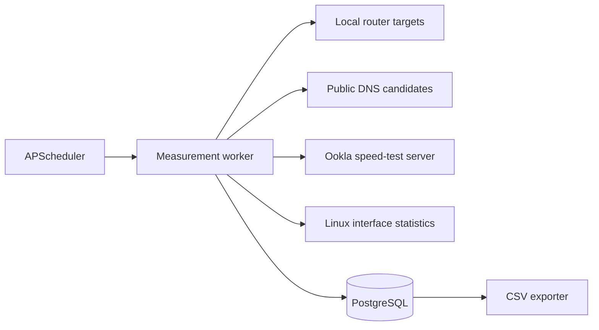

# Home Network Monitor

Home Network Monitor is a self-hosted Docker application that measures the
quality of a home or small-office internet connection on a regular schedule.
It records local-router reachability, public DNS latency, internet throughput,
and network-interface health in PostgreSQL, with a CSV exporter for analysis.

The default schedule runs four times per day: 00:00, 06:00, 12:00, and 18:00
in the configured timezone.

## How it works



The measurement container uses Linux host networking. This is intentional: a
normally bridged container would see Docker's virtual gateway and interfaces,
not the host's real route to the home router. PostgreSQL remains isolated and
is published only on the host loopback address by default.

Each run performs the following sequence:

1. Detect the host's default IPv4 route and active interface.
2. Record wired link state or Wi-Fi signal and negotiated bitrate.
3. Measure packet loss, latency, and jitter to one or more local router hops.
4. Probe configured public DNS resolvers and select the lowest-latency target.
5. Run a longer packet-loss test against the selected resolver.
6. Run the official Ookla command-line speed test.
7. Store one normalized report row and the raw speed-test response.

## Recorded measurements

- Interface name, wired speed/duplex, or Wi-Fi signal and radio bitrate
- Receive/transmit error, drop, and collision deltas
- Router packet loss, minimum/average/maximum latency, and jitter
- Public DNS selection, packet loss, latency, and jitter
- Download and upload throughput
- Idle and loaded latency, jitter, and reported packet loss
- ISP and speed-test server metadata
- Speedtest result URL when supplied by the provider

## Requirements

- Linux host
- Docker Engine with Docker Compose v2 or newer
- AMD64 or ARM64 CPU
- Internet access while building the image and running tests

The image downloads the official Ookla CLI during its build. Ookla's CLI is
subject to its own EULA, terms, and privacy policy and is intended for personal,
non-commercial command-line use. Starting a test accepts those terms through
the CLI flags.

## Quick start

Copy the example configuration and replace the database password:

```sh
cp .env.example .env
chmod 600 .env
```

Generate a password without placing it in shell history, for example:

```sh
python3 -c 'import secrets; print(secrets.token_hex(32))'
```

Set `POSTGRES_PASSWORD` in `.env`, then validate and start the stack:

```sh
docker compose config
docker compose up -d --build
docker compose logs -f monitor
```

`RUN_ON_START=true` records an immediate baseline. Scheduled measurements then
run according to `SCHEDULE`.

## Router and DNS configuration

`auto` resolves to the host's default IPv4 gateway. Add other comma-separated
router addresses when the route includes a mesh gateway, upstream router, or
other local hop:

```dotenv
ROUTER_TARGETS=auto,192.168.1.1
DNS_CANDIDATES=9.9.9.9,1.1.1.1,8.8.8.8
```

Run an additional measurement manually with:

```sh
docker compose exec monitor netwatch once
```

## Export CSV

Export all stored runs into the bind-mounted `exports` directory:

```sh
docker compose exec monitor netwatch export \
  --output /exports/network-results.csv
```

The resulting host file is `exports/network-results.csv`. The CSV includes
headers for interface state, router and DNS measurements, throughput, loaded
latency, provider/server metadata, and interface error counters.

To stream the CSV to standard output:

```sh
docker compose exec monitor netwatch export > network-results.csv
```

## Operations

```sh
# Service and health status
docker compose ps

# Recent scheduler and measurement logs
docker compose logs --tail=100 monitor

# Stop while preserving stored results
docker compose down

# Remove services and all stored results (destructive)
docker compose down -v
```

PostgreSQL listens on `127.0.0.1:55432` by default. Change `POSTGRES_PORT` if
that port is already occupied.

## Privacy and security

The repository contains no measurement results, credentials, public addresses,
or deployment-specific host information. Runtime files are excluded through
`.gitignore`.

Measurements can contain a public IP address, ISP name, local router addresses,
and provider result URL. Treat the PostgreSQL volume and CSV exports as private
operational data. Do not commit or publish them. See [PRIVACY.md](PRIVACY.md)
and [SECURITY.md](SECURITY.md) before operating a public deployment.

## Development

Run the unit tests in the same container environment used by CI:

```sh
docker build --target test -t home-network-monitor:test .
```

The application code is under `src/netwatch`. `measure.py` performs network
collection, `database.py` owns schema and CSV mapping, and `cli.py` provides the
scheduler and one-shot/export commands.

## License

The application source is available under the MIT License. The bundled-at-build
Ookla executable remains governed by Ookla's separate terms.
